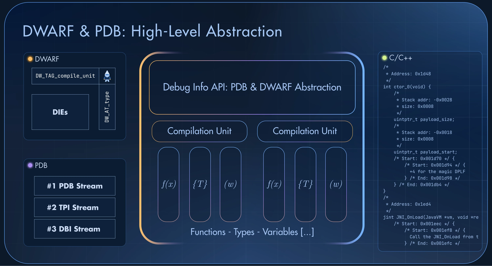
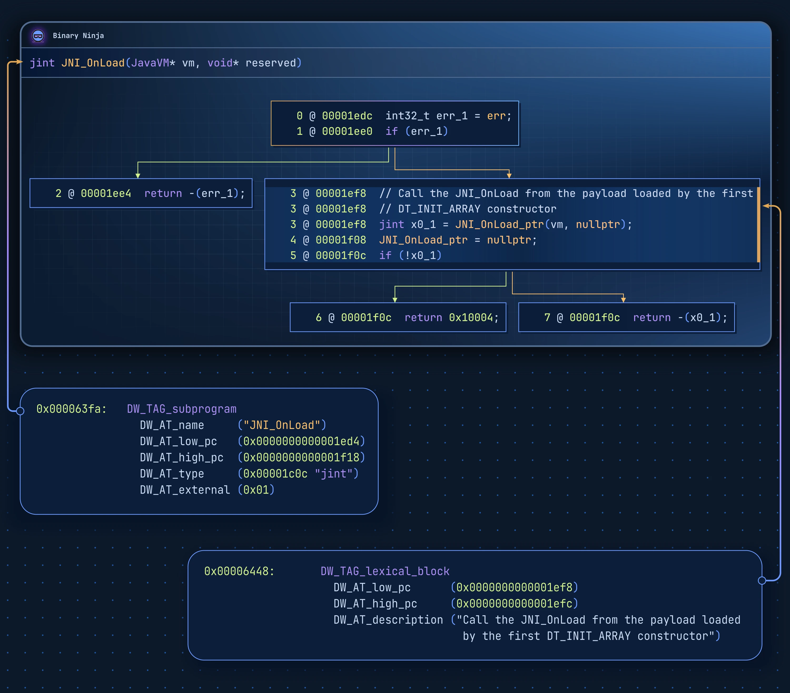
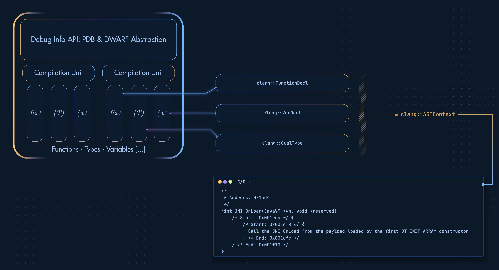

# Lypid

> A user-friendly library for inspecting DWARF and PDB debug information, and generating DWARF.

Lypid provides a modern C++ API for navigating DWARF and PDB debug information.
Compilation units, functions, variables, types, public symbols, and source-line
data can all be inspected through a consistent API that does not require a deep
understanding of the internal structure of these debug formats.

DWARF and PDB each have their own specification. As a developer or reverse
engineer, we might want to access the debug information through concepts that are
close to the original source code, including its **hierarchical scopes**:
Compilation Units -> Functions -> Stack Variables.

Several libraries exist to inspect and analyze DWARF or PDB, in different
languages:

| Name                                                                     | Language | Format     |
|--------------------------------------------------------------------------|----------|------------|
| [LLVM](https://github.com/llvm/llvm-project/tree/main/llvm/lib/DebugInfo) | C++      | DWARF, PDB |
| [pyelftools](https://github.com/eliben/pyelftools)                       | Python   | DWARF      |
| [getsentry/pdb](https://github.com/getsentry/pdb)                        | Rust     | PDB        |

These libraries implement most of the DWARF and PDB specifications, but they do
not provide a higher level of abstraction that eases the manipulation of these
formats or the creation of DWARF files. LLVM also provides the
[`LogicalView`](https://llvm.org/docs/CommandGuide/llvm-debuginfo-analyzer.html)
library, whose purpose is to provide a unified, high-level, and format-agnostic
logical representation of the debug information.

I created Lypid around at the same time as the `LogicalView` library landed in
LLVM. While both projects share a similar goal, Lypid is oriented toward reverse
engineering, as described in this blog post:
[DWARF as a Shared Reverse Engineering Format](https://lief.re/blog/2025-05-27-dwarf-editor/).

Lypid relies on LLVM's _low-level_ DWARF and PDB primitives and provides Python
and Rust bindings through
[LIEF Extended](https://lief.re/doc/latest/extended/debug_info/index.html).



The next sections detail some use cases where this kind of abstraction is
convenient.

## DWARF Function Address

A must-have feature for a library that provides a user-friendly API over DWARF
is to expose the addresses of the functions (`DW_TAG_subprogram`):

```cpp
std::unique_ptr<lypid::dwarf::DebugInfo>
  debug_info = lypid::dwarf::DebugInfo::from_file("libnative.so");

std::optional<lypid::dwarf::Function>
  func = debug_info->find_function("my_function");

std::println("{}: {:#010x}", func->name(), *func->addr());
```

Depending on the compiler and the DWARF version, the address of a function can
be described by different attributes:

1. `DW_AT_entry_pc`
2. `[DW_AT_low_pc, DW_AT_high_pc]`
3. `DW_AT_ranges`

In most cases, users only care about the address, not about the subtle
difference between the contiguous `[DW_AT_low_pc, DW_AT_high_pc]` range and the
non-contiguous `DW_AT_ranges`.

`lypid::dwarf::Function::addr()` abstracts these attributes and returns a
single `std::optional<uint64_t>`, while `lypid::dwarf::Function::ranges()`
still exposes all the address ranges of the function.

## DWARF Variable Address

Accessing the address of a DWARF variable (`DW_TAG_variable`) can also be
tricky, depending on the compiler and the DWARF version. For instance, let's
take the following code:

```cpp
static int g_bar = 1;

int main() {
  return g_bar;
}
```

which is compiled with Clang 24 using the following arguments:

```bash
$ clang++ -O0 -g -gdwarf-5 -no-pie ./main.cpp -o main
```

If we look at the DWARF definition of `g_bar`, we get this:

```bash
$ llvm-dwarfdump --name=g_bar main

0x00000032: DW_TAG_variable
              DW_AT_name         ("g_bar")
              DW_AT_type         (0x0000003e "int")
              DW_AT_decl_file    ("/home/romain/scratch/bp/./main.cpp")
              DW_AT_decl_line    (1)
              DW_AT_location     (DW_OP_addrx 0x1)
              DW_AT_linkage_name ("_ZL5g_bar")
```

`DW_AT_location` does not encode the address directly: `DW_OP_addrx 0x1` is an
index into the `.debug_addr` table of the compilation unit:

```bash
$ llvm-dwarfdump --debug-addr main

.debug_addr contents:
Address table header: length = 0x00000014, format = DWARF32, version = 0x0005, addr_size = 0x08, seg_size = 0x00
Addrs: [
0x0000000000401120
0x0000000000404010
]
```

The entry at index 1 holds the address of `g_bar`:

```bash
$ llvm-readelf -s main | grep g_bar
    12: 0000000000404010     4 OBJECT  LOCAL  DEFAULT    22 _ZL5g_bar
```

Lypid abstracts the address resolution of global and stack variables behind a
simple API: `std::optional<int64_t> lypid::dwarf::Variable::addr()`. It returns
the absolute address of a global variable, or the frame-base offset
(`DW_OP_fbreg`) of a stack variable.

Under the hood, Lypid decodes the `DW_AT_location` of a `DW_TAG_variable` with
LLVM's `DWARFExpression`. It handles addresses (`DW_OP_addr`, `DW_OP_addrx`),
registers, frame-base and register offsets, location lists, and composite
locations (`DW_OP_piece`, `DW_OP_bit_piece`).

## DWARF Creator

As described in the
[DWARF as a Shared Reverse Engineering Format](https://lief.re/blog/2025-05-27-dwarf-editor/)
blog post, Lypid is also the core component that my reverse-engineering
workflow uses to keep reverse-engineering information in a tool-agnostic file.

For instance, functions are described with `DW_TAG_subprogram`, basic blocks
with `DW_TAG_lexical_block`, and comments with `DW_AT_description`:



For more details about this part, see the
[DWARF editor documentation](https://lief.re/doc/latest/extended/dwarf/index.html#dwarf-editor)
in LIEF.

## PDB

While the DWARF format organizes each compilation unit as a tree of DIEs, a PDB is a
[Multi-Stream File](https://llvm.org/docs/PDB/MsfFile.html).
This design supports incremental and atomic updates of the file without rewriting
it entirely.

Fixed streams contain the global information. For instance, the PDB stream #1 contains
the GUID and the age that match the PDB with its executable. The TPI stream #2 stores
the type records, and the DBI stream #3 lists the modules (compilation units)
with their source files.

Lypid abstracts this stream-based design to expose nearly the same interface as
the DWARF API:

```cpp
#include <lypid/PDB/DebugInfo.hpp>

#include <print>

int main() {
  std::unique_ptr<lypid::pdb::DebugInfo> info =
    lypid::pdb::DebugInfo::from_file("arm64ec_hello_world.pdb");

  for (const lypid::pdb::CompilationUnit& CU : info->compilation_units()) {
    // Abstract the build information of a PDB module, which can be
    // described by S_COMPILE3, S_COMPILE2, S_ENVBLOCK, and S_BUILDINFO
    if (std::optional<lypid::pdb::BuildMetadata> meta = CU.build_metadata()) {
      std::println("{}", meta->to_string());
    }

    for (const lypid::pdb::Function& F : CU.functions()) {
      std::println("{:#010x}: {}", F.RVA(), F.name());
    }
  }
  return 0;
}
```

Note that in this example, `lypid::pdb::DebugInfo::compilation_units()` and
`lypid::pdb::CompilationUnit::functions()` are **lazy** iterators: a module
stream is only loaded when its compilation unit is accessed, and its symbols
are only decoded during the iteration. The user only pays for the
deserialization of the elements that are accessed. Therefore, loading a
multi-gigabyte PDB stays within reasonable time and memory bounds.

## DWARF & PDB to C/C++

Last but not least, Lypid exposes an API to transform DWARF and PDB elements
into a Clang AST from which it emits C/C++ declarations:



Given the previous `JNI_OnLoad` example, the generated C/C++ declaration looks
like this:

```cpp
/*
 * Address: 0x1ed4
 */
jint JNI_OnLoad(JavaVM *vm, void *reserved) {
    /* Start: 0x001eec */ {
        /* Start: 0x001ef8 */ {
          Call the JNI_OnLoad from the payload loaded by the first DT_INIT_ARRAY constructor
        } /* End: 0x001efc */
    } /* End: 0x001f10 */
}
// Generated with `lief-dwarfdump --function JNI_OnLoad libdexprotector.so.dwarf`
```

The [`lief-dwarfdump`](https://lief.re/doc/latest/tools/lief-dwarfdump/index.html)
command-line tool from LIEF Extended is a front end for this API.
